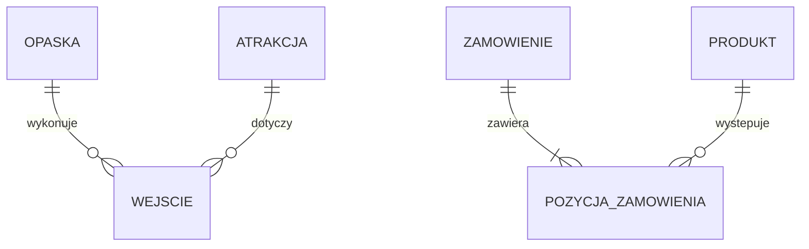

# Wirgo – Road Map projektu v1 (Laboratorium 02)

## 1. Cel i zakres v1

**Tytuł:** Wirgo – System Obsługi i Zarządzania Parkiem Rozrywki.

**Odbiorcy:** pracownicy parku rozrywki: kasjerzy, technicy i osoby kontrolujące wejścia.

**Cel v1:** pracownik może wydać wirtualną opaskę, sprawdzić i doładować saldo, utworzyć zamówienie gastronomiczne, zmienić stan atrakcji oraz zasymulować kontrolę wejścia. Aplikacja działa w przeglądarce i używa przykładowych danych. Kontrola RFID polega na wpisaniu identyfikatora, bez prawdziwego sprzętu. System wyświetla informację o zaakceptowaniu lub odrzuceniu operacji. W v1 nie ma płatności internetowych, logowania ani integracji z urządzeniami.

### 1.1. MVP

| Funkcja | Nazwa | Iteracja |
|---|---|---|
| F01 | Sprzedaż biletów/karnetów, wydawanie opasek | v1 |
| F02 | Sprawdzanie i doładowanie stanu opaski | v1 |
| F03 | Tworzenie zamówień gastronomicznych | v1 |
| F05 | Sprawdzanie i zmiana statusu atrakcji | v1 |
| F06 | Symulowana weryfikacja wejścia | v1 |

**Odłożone do v2:** F04 – pełna obsługa zamówień przez kucharza oraz F07 – harmonogramy pracowników. Prototyp zawiera już demonstracyjne zakładki tych funkcji, ale nie są one częścią wymaganej piątki MVP.

## 2. Cykl iteracyjny

Widoki → struktura bazy → funkcjonalności → sprawdzenie spójności. W v2 cykl powtórzymy po rozszerzeniu zakresu.

## 3. Widoki

| ID | Widok | Kto i po co korzysta | Funkcje |
|---|---|---|---|
| W01 | Kasjer | Kasjer wydaje opaski, sprawdza saldo, przyjmuje zamówienie | F01, F02, F03 |
| W03 | Technik | Technik przegląda i zmienia stan atrakcji | F05 |
| W04 | Bramka | Pracownik kontroluje uprawnienie do wejścia | F06 |
| W02 | Kucharz (plan v2) | Zmiana statusów zamówień | F04 |
| W05 | Menedżer (plan v2) | Planowanie zmian pracowników | F07 |

**Szkice v1:** [W01 – kasjer](widok-w01.svg), [W03 – technik](widok-w03.svg), [W04 – bramka](widok-w04.svg). Strzałki na szkicach symbolizują nawigację zakładkami w górnym pasku.

### W01 – Kasjer

Dane wyświetlane: formularz biletu/karnetu, numer i saldo opaski, produkty i ceny, bieżący koszyk. Dane wprowadzane: typ biletu, żetony lub okres karnetu, identyfikator opaski, ilości produktów. Sukces: potwierdzenie z nowym ID, saldem lub numerem zamówienia. Błąd: brak opaski, ujemna liczba żetonów, puste zamówienie.

### W03 – Technik

Dane wyświetlane: nazwa, koszt wejścia i bieżący status atrakcji. Dane wprowadzane: wybór nowego statusu. Sukces: status widoczny na liście i uwzględniany na bramce. Błąd: nieistniejąca atrakcja albo niepoprawny status.

### W04 – Bramka

Dane wyświetlane: lista atrakcji i statusy, identyfikatory demonstracyjne opasek, wynik próby. Dane wprowadzane: ID opaski i atrakcja. Sukces: komunikat o wejściu i odjęcie żetonów albo zaakceptowanie ważnego karnetu. Błąd: nieznana opaska, wygasły karnet, zbyt mało żetonów albo zamknięta atrakcja.

## 4. Struktura bazy danych (SQLite)

| Tabela | Pola i typy |
|---|---|
| `opaska` | `id TEXT PK`, `typ TEXT`, `zetony INTEGER`, `wazna_do TEXT` (data/godzina ISO), `wlasciciel TEXT`, `utworzono TEXT` |
| `atrakcja` | `id INTEGER PK`, `nazwa TEXT`, `koszt INTEGER`, `status TEXT` |
| `produkt` | `id TEXT PK`, `nazwa TEXT`, `cena_grosze INTEGER`, `ikona TEXT` |
| `zamowienie` | `id INTEGER PK`, `status TEXT`, `utworzono TEXT`, `suma_grosze INTEGER` |
| `pozycja_zamowienia` | `id INTEGER PK`, `zamowienie_id INTEGER FK`, `produkt_id TEXT FK`, `ilosc INTEGER`, `cena_grosze INTEGER` |
| `wejscie` | `id INTEGER PK`, `opaska_id TEXT FK`, `atrakcja_id INTEGER FK`, `koszt_zetonow INTEGER`, `czas TEXT` |

**Schemat relacji:** [schemat-bazy.svg](schemat-bazy.svg)

Relacje są typu **1:N**: jedna opaska może mieć wiele wejść, atrakcja wiele wejść, zamówienie wiele pozycji, produkt może występować w wielu pozycjach.

## 5. Funkcjonalności v1

| ID | Użytkownik / widok | Dane | Oczekiwane działanie i warunek poprawności | Najważniejszy błąd |
|---|---|---|---|---|
| F01 | Kasjer / W01 | opaska | Nowy unikalny identyfikator, dodatnie żetony albo karnet 1/3/7 dni; potwierdzenie wydania | Niedodatnia liczba żetonów |
| F02 | Kasjer / W01 | opaska | Wyszukanie salda i dopisanie dodatniej liczby żetonów do istniejącej opaski żetonowej | Opaska nie istnieje lub doładowanie <=0 |
| F03 | Kasjer / W01 | produkt, zamowienie, pozycja_zamowienia | Zapis co najmniej jednej pozycji z ilością >0; cena liczona wg menu | Puste zamówienie lub nieznany produkt |
| F05 | Technik / W03 | atrakcja | Zapis jednego z czterech dozwolonych statusów i odświeżenie listy | Błędny status |
| F06 | Obsługa bramki / W04 | opaska, atrakcja, wejscie | Zgoda tylko dla działającej atrakcji i ważnego karnetu lub odpowiedniej liczby żetonów; zapis wejścia | Brak żetonów, nieznana opaska, zamknięta atrakcja |

## 6. Mapa prac v1

W tabeli `Osoba 1` i `Osoba 2` to miejsca na dane członków zespołu; rzeczywisty termin należy wpisać zgodnie z kalendarzem laboratorium.

| Zadanie | Odpowiedzialny | Termin | Zależność | Rezultat |
|---|---|---|---|---|
| Cel i wybór 5 funkcji | Osoba 1 | do następnych zajęć | Lab 01 | lista MVP |
| W01 i W04 – szkice | Osoba 1 | do następnych zajęć | zakres v1 | 2 szkice |
| W03 – szkic | Osoba 2 | do następnych zajęć | zakres v1 | 1 szkic |
| Tabele i relacje | Osoba 2 | do następnych zajęć | szkice | diagram bazy |
| Opisy F01–F03 | Osoba 1 | do następnych zajęć | widoki i baza | opisy warunków |
| Opisy F05–F06 | Osoba 2 | do następnych zajęć | widoki i baza | opisy warunków |
| Sprawdzenie spójności i dokumentacja | Osoba 1 + Osoba 2 | do następnych zajęć | wszystkie etapy | mapa v1 gotowa |

## 7. Pomysły na v2

**Pomysł A – rozbudowana obsługa kuchni (F04).** Cel: kucharz może sam zmieniać status realizacji zamówienia. **Widoki:** rozwinięcie W02 z listą i przyciskami. **Dane:** dalsze wykorzystanie `zamowienie` i `pozycja_zamowienia`, opcjonalne czasy rozpoczęcia i zakończenia przygotowania. **Funkcje:** filtrowanie zamówień i statusy `Oczekujące`, `W trakcie`, `Zrealizowane`, `Nieodebrane`.

**Pomysł B – harmonogramy pracowników (F07).** Cel: menedżer planuje zmiany. **Widoki:** rozbudowanie W05 z dodawaniem i usuwaniem wpisów. **Dane:** nowe tabele `pracownik` i `harmonogram` z datami/godzinami, relacja 1:N. **Funkcje:** zapis grafiku, przeglądanie, edycja/usuwanie; opcjonalna kontrola nakładania się godzin.

## 8. Sprawdzenie kompletności

F01/F02/F03 mają W01 i tabele, F05 ma W03 i `atrakcja`, F06 ma W04 i tabele `opaska`, `atrakcja`, `wejscie`. Powiązania widoków, danych i funkcji są zgodne. Link do mapy znajduje się w README; link do LaboChat, osoby odpowiedzialne i rzeczywiste commity muszą uzupełnić członkowie zespołu.
